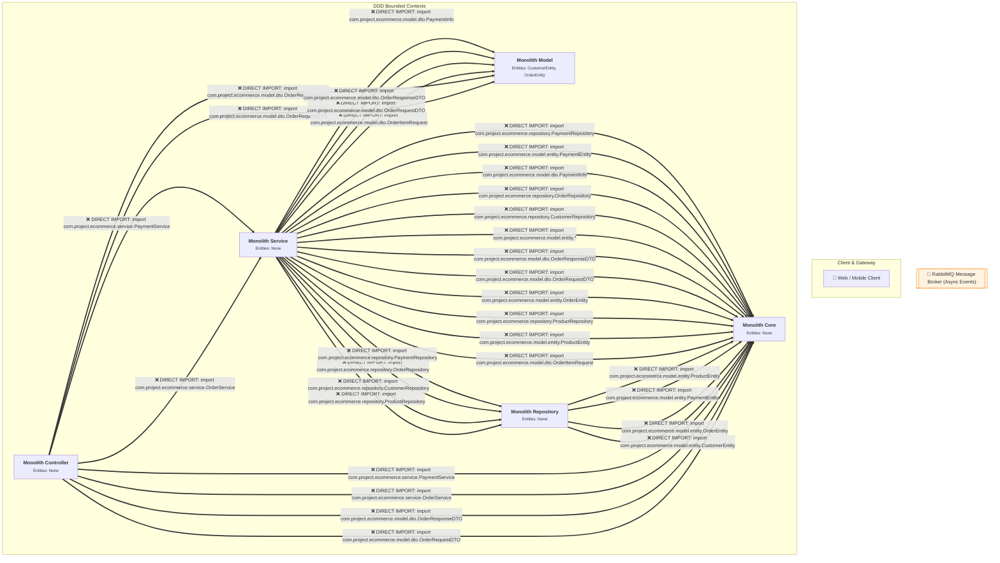

# 🏛️ Architecture Governance & AI Bounded Context Report

> **CI/CD Quality Gate**: 🟢 **PASSED** | **Architecture Health Score**: `100/100` | **AI Mode**: `OFFLINE_EXPERT_AI`

## 1. Executive Summary
Kiến trúc hệ thống tuân thủ 100% ranh giới Bounded Context theo chuẩn Domain-Driven Design (DDD).

### Key Architectural Insights:
- Các service hoàn toàn tách biệt dữ liệu theo mẫu Database-per-Service.
- Giao tiếp đồng bộ chỉ giới hạn qua HTTP REST Client với Data Transfer Objects (DTO) tối thiểu.
- Các thay đổi trạng thái liên service được điều phối thông qua sự kiện bất đồng bộ (Saga Choreography) trên Message Broker.
- Không phát hiện tình trạng rò rỉ Aggregate Root hay thực thể nội bộ (Entity Leakage).

## 2. Reverse-Engineered Dependency Graph (Actual Architecture)

## 3. ✅ Ranh giới Bounded Context hoàn toàn sạch sẽ!
Mọi dịch vụ tuân thủ nguyên tắc **Database-per-Service** và không có hiện tượng rò rỉ mã nguồn giữa các ngữ cảnh.