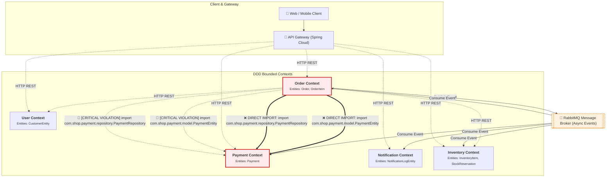

# 🏛️ Architecture Governance & AI Bounded Context Report

> **CI/CD Quality Gate**: 🔴 **FAILED** | **Architecture Health Score**: `30/100` | **AI Mode**: `OFFLINE_EXPERT_AI`

## 1. Executive Summary
Hệ thống phát hiện 2 vi phạm ranh giới Bounded Context nghiêm trọng. Build bị chặn!

### Key Architectural Insights:
- Phát hiện 2 liên kết phụ thuộc trực tiếp (Direct Import Coupling) xuyên qua ranh giới Bounded Context.
- Nguy cơ cao gây xói mòn kiến trúc và biến hệ thống thành Distributed Monolith.
- Yêu cầu refactor mã nguồn theo mẫu Domain Events hoặc Anti-Corruption Layer trước khi merge vào main branch.

## 2. Reverse-Engineered Dependency Graph (Actual Architecture)


## 3. 🚨 Detected Bounded Context Violations
### Violation #1: Rò rỉ thực thể miền và vi phạm Bounded Context: order-service ➔ payment-service
- **Severity**: `CRITICAL`
- **Location**: `order-service/src/main/java/com/shop/order/service/OrderService.java:3`
- **Evidence**: `import com.shop.payment.model.PaymentEntity`

**DDD Architectural Analysis**:
Trong thiết kế Domain-Driven Design (DDD), mỗi Bounded Context sở hữu một mô hình khái niệm (Ubiquitous Language) và cơ sở dữ liệu riêng biệt. Việc `order-service` trực tiếp import `import com.shop.payment.model.PaymentEntity` từ `payment-service` đã phá vỡ hoàn toàn tính tự chủ (Autonomous) của Bounded Context.

**Architectural Impacts:**
- ⚠️ Xói mòn kiến trúc (Architectural Erosion): Biến kiến trúc Microservices phân tán thành 'Distributed Monolith' (Monolith phân tán) mang mọi nhược điểm của cả hai bên.
- ⚠️ Phá vỡ Database-per-Service: Gây phụ thuộc chặt chẽ vào cấu trúc bảng và mô hình dữ liệu nội bộ của service khác, ngăn cản việc thay đổi schema độc lập.
- ⚠️ Rủi ro Distributed Transaction: Khi gọi chéo model/repository trực tiếp mà không qua Transaction Coordinator, mọi lỗi runtime đều gây mất nhất quán dữ liệu vĩnh viễn (data inconsistency).

**Recommended Remediation Plan:**
- 1. Loại bỏ hoàn toàn câu lệnh `import com.shop.payment.model.PaymentEntity` trong file `order-service/src/main/java/com/shop/order/service/OrderService.java`.
- 2. Nếu cần dữ liệu từ `payment-service`, hãy định nghĩa một Value Object hoặc DTO thuần túy trong `order-service` và sử dụng Anti-Corruption Layer (ACL).
- 3. Nếu là luồng cập nhật nghiệp vụ sau khi đặt hàng, hãy sử dụng cơ chế Asynchronous Event Choreography (phát tán `OrderCreatedEvent` vào RabbitMQ và để listener của service tương ứng tự xử lý).

**Refactoring Code Example:**
```java
// [GIẢI PHÁP REFACTOR CHUẨN DDD]
// Thay vì import Entity trực tiếp từ Bounded Context khác:
//   import com.shop.payment.model.PaymentEntity;  <-- XÓA DÒNG NÀY

// Hãy sử dụng Asynchronous Domain Event:
eventPublisher.publishOrderCreated(OrderCreatedEvent.from(order));
// Sau đó PaymentService sẽ tự subscribe và quản lý PaymentEntity trong database riêng của nó.
```

### Violation #2: Rò rỉ thực thể miền và vi phạm Bounded Context: order-service ➔ payment-service
- **Severity**: `CRITICAL`
- **Location**: `order-service/src/main/java/com/shop/order/service/OrderService.java:4`
- **Evidence**: `import com.shop.payment.repository.PaymentRepository`

**DDD Architectural Analysis**:
Trong thiết kế Domain-Driven Design (DDD), mỗi Bounded Context sở hữu một mô hình khái niệm (Ubiquitous Language) và cơ sở dữ liệu riêng biệt. Việc `order-service` trực tiếp import `import com.shop.payment.repository.PaymentRepository` từ `payment-service` đã phá vỡ hoàn toàn tính tự chủ (Autonomous) của Bounded Context.

**Architectural Impacts:**
- ⚠️ Xói mòn kiến trúc (Architectural Erosion): Biến kiến trúc Microservices phân tán thành 'Distributed Monolith' (Monolith phân tán) mang mọi nhược điểm của cả hai bên.
- ⚠️ Phá vỡ Database-per-Service: Gây phụ thuộc chặt chẽ vào cấu trúc bảng và mô hình dữ liệu nội bộ của service khác, ngăn cản việc thay đổi schema độc lập.
- ⚠️ Rủi ro Distributed Transaction: Khi gọi chéo model/repository trực tiếp mà không qua Transaction Coordinator, mọi lỗi runtime đều gây mất nhất quán dữ liệu vĩnh viễn (data inconsistency).

**Recommended Remediation Plan:**
- 1. Loại bỏ hoàn toàn câu lệnh `import com.shop.payment.repository.PaymentRepository` trong file `order-service/src/main/java/com/shop/order/service/OrderService.java`.
- 2. Nếu cần dữ liệu từ `payment-service`, hãy định nghĩa một Value Object hoặc DTO thuần túy trong `order-service` và sử dụng Anti-Corruption Layer (ACL).
- 3. Nếu là luồng cập nhật nghiệp vụ sau khi đặt hàng, hãy sử dụng cơ chế Asynchronous Event Choreography (phát tán `OrderCreatedEvent` vào RabbitMQ và để listener của service tương ứng tự xử lý).

**Refactoring Code Example:**
```java
// [GIẢI PHÁP REFACTOR CHUẨN DDD]
// Thay vì import Entity trực tiếp từ Bounded Context khác:
//   import com.shop.payment.model.PaymentEntity;  <-- XÓA DÒNG NÀY

// Hãy sử dụng Asynchronous Domain Event:
eventPublisher.publishOrderCreated(OrderCreatedEvent.from(order));
// Sau đó PaymentService sẽ tự subscribe và quản lý PaymentEntity trong database riêng của nó.
```
